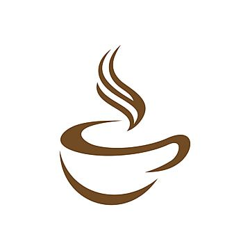

# Ngopi Sama Kamu ☕
### *Tempat Pulang Sejenak, Ngobrol Santai, dan Nikmati Secangkir Kopi Hangat*

<p align="center">
  
</p>

<p align="center">
  <a href="https://github.com/aldwrnnnnn/ngopisamakamu"></a>
  <a href="LICENSE"></a>
  
  
  
</p>

---

> ### 🛡️ Watermark & Pernyataan Kepemilikan Hak Cipta
> Proyek **"Ngopi Sama Kamu"** ini dirancang, dibangun, dan dimiliki sepenuhnya secara sah oleh **[I Gede Aldi Irawan (@aldwrnnnnn)](https://github.com/aldwrnnnnn)**.
> 
> Seluruh kode sumber, arsitektur komponen, tata letak antarmuka (UI/UX), dan aset grafis dilindungi hak cipta (*All Rights Reserved*). 
> **Dilarang keras**:
> - Mengklaim proyek ini sebagai karya/portofolio pribadi milik pihak lain.
> - Menyalin, mendistribusikan ulang, melisensikan ulang, atau memperjualbelikan kode sumber ini tanpa izin tertulis dari pemilik hak cipta.
> - Menghapus identitas pengembang atau watermark dari berkas repositori ini.

---

## 📖 Tentang Proyek

**Ngopi Sama Kamu** adalah platform web profil dan pemesanan langsung (*direct ordering*) untuk sebuah kedai kopi bergaya *artisan cozy* yang berlokasi di Abiansemal, Badung, Bali. 

Website ini dirancang bukan sekadar sebagai etalase digital, melainkan sebagai perpanjangan ruang fisik kedai yang menghadirkan rasa tenang, hangat, bersahabat, dan tanpa ketergesaan (*unhurried*). Dilengkapi dengan alur pemesanan instan ke WhatsApp, pelanggan dapat memesan menu favorit, menentukan suhu dan takaran gula, hingga melakukan reservasi tempat tanpa melewati alur checkout yang berbelit-belit.

---

## ✨ Fitur-Fitur Unggulan

- ☕ **Katalog Menu Interaktif & Transparan**
  - Penyajian menu lengkap dengan foto asli, deskripsi rasa jujur, serta harga transparan.
  - Filter kategori dinamis: *Kopi Pilihan*, *Non-Kopi Segar*, dan *Camilan & Pastry*.
  - Label indikator preferensi (*Best Seller*, *Artisan Pick*, *Vegan Friendly*).
- 📲 **Sistem Pemesanan Langsung via WhatsApp**
  - Pelanggan dapat memilih opsi suhu minuman (*Dingin / Hangat*), tingkat kemanisan (*Normal, Less Sugar, No Sugar*), kuantitas, dan catatan khusus.
  - Secara otomatis menyusun format pesan WhatsApp terstruktur dan langsung terhubung ke nomor admin kedai.
- 🌿 **Cerita Suasana & Sudut Kedai**
  - Bagian narasi yang menceritakan fasilitas kedai: area kerja kondusif dengan colokan di setiap meja, Wi-Fi kencang, bar seduh manual (*manual brew*), dan sudut baca santai.
- 📍 **Informasi Kunjungan & Jam Operasional**
  - Status buka/tutup harian (08.00 - 22.00 WITA).
  - Alamat lengkap di Abiansemal, Badung, Bali lengkap dengan rute Google Maps satu kali klik.
- 📱 **Desain Mobile-First & Aksesibilitas Tinggi**
  - Tipografi harmonis menggunakan kombinasi *Fraunces* (display artisan hangat) dan *Plus Jakarta Sans* (keterbacaan optimal).
  - Palet warna nyaman di mata (*Oatmeal*, *Roasted Espresso*, *Warm Caramel*).
  - Memenuhi standar kontras WCAG AA/AAA dan navigasi keyboard yang ramah pengguna.

---

## 🛠️ Tumpukan Teknologi (Tech Stack)

| Komponen | Teknologi |
| :--- | :--- |
| **Framework Backend** | [Laravel 12](https://laravel.com/) (PHP 8.3) |
| **Frontend Styling** | [Tailwind CSS](https://tailwindcss.com/) |
| **Templating Engine** | Laravel Blade |
| **Asset Bundler** | [Vite](https://vitejs.dev/) |
| **Typography** | Google Fonts (*Fraunces* & *Plus Jakarta Sans*) |
| **Integrasi Kontak** | WhatsApp Direct API Protocol |
| **Web Server Lokal** | Laragon / Nginx / Apache |

---

## 📁 Struktur Direktori Utama

```text
ngopisamakamu/
├── app/                  # Controller & logika inti aplikasi Laravel
├── bootstrap/            # Inisialisasi dan konfigurasi aplikasi
├── config/               # Berkas konfigurasi sistem
├── database/             # Migrasi & seeder database
├── public/               # Titik masuk publik (index.php) & aset gambar (public/images)
├── resources/
│   ├── css/              # Konfigurasi Tailwind CSS (app.css)
│   ├── js/               # Skrip interaktivitas frontend (app.js)
│   └── views/            # Tampilan Blade (welcome.blade.php, errors/404.blade.php)
├── routes/               # Rute web dan konsol
├── storage/              # Penyimpanan sesi, view terkompilasi, dan log
├── tests/                # Unit & Feature tests
├── DESIGN.md             # Panduan estetika, warna, dan filosofi desain
├── LICENSE               # Lisensi hak cipta resmi proyek
└── README.md             # Dokumentasi proyek & informasi lisensi
```

---

## 🚀 Panduan Instalasi Lokal

Jika Anda ingin menjalankan proyek ini di lingkungan lokal untuk keperluan pembelajaran:

### 1. Prasyarat
- PHP >= 8.2 (Direkomendasikan PHP 8.3)
- Composer
- Node.js >= 18.x & npm
- Git

### 2. Kloning Repositori
```bash
git clone https://github.com/aldwrnnnnn/ngopisamakamu.git
cd ngopisamakamu
```

### 3. Pasang Dependensi
```bash
composer install
npm install
```

### 4. Konfigurasi Lingkungan (.env)
```bash
cp .env.example .env
php artisan key:generate
```

### 5. Jalankan Server Pengembangan
Buka dua jendela terminal terpisah atau jalankan perintah berikut:

```bash
# Terminal 1: Kompilasi aset Vite
npm run dev

# Terminal 2: Jalankan server Laravel
php artisan serve
```

Akses aplikasi di peramban Anda melalui: `http://localhost:8000` (atau via virtual host Laragon: `http://ngopisamakamu.test`).

---

## ⚖️ Hak Cipta & Lisensi

Hak Cipta © 2026 **I Gede Aldi Irawan**. Seluruh Hak Dilindungi Undang-Undang (*All Rights Reserved*).

Proyek ini dilindungi di bawah lisensi hak cipta privat/proprietari. Kode sumber dan seluruh aset grafis di dalam repositori ini disediakan untuk tujuan peninjauan portofolio dan referensi pembelajaran non-komersial. Penggunaan ulang, modifikasi, penjualan, maupun redistribusi komersial tanpa izin tertulis dari pemilik hak cipta dilarang keras. 

Lihat berkas [LICENSE](LICENSE) untuk ketentuan hukum lengkap.

---

## 👤 Pengembang & Kontak

Proyek ini dirancang dan dikembangkan dengan penuh dedikasi oleh:

* **Nama Pengembang:** I Gede Aldi Irawan
* **GitHub:** [@aldwrnnnnn](https://github.com/aldwrnnnnn)
* **Email:** [gedealdiirawan5@gmail.com](mailto:gedealdiirawan5@gmail.com)
* **Lokasi:** Badung, Bali, Indonesia

---
<p align="center">
  <sub>Diseduh dan dikembangkan dengan sepenuh hati © 2026 <b>Ngopi Sama Kamu</b>.</sub>
</p>
